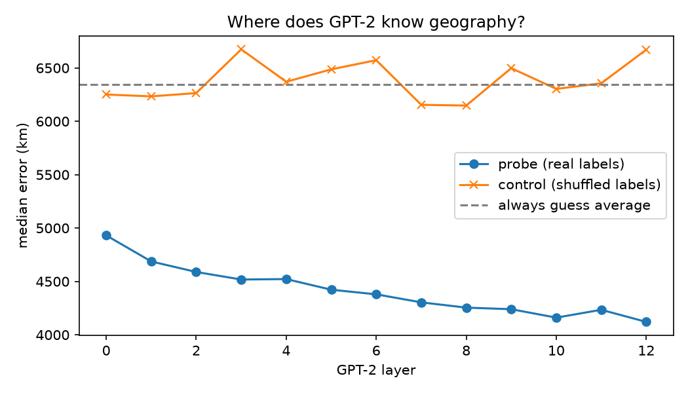
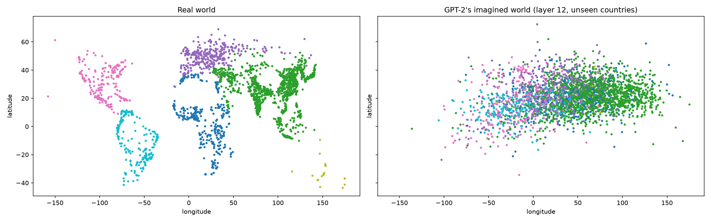
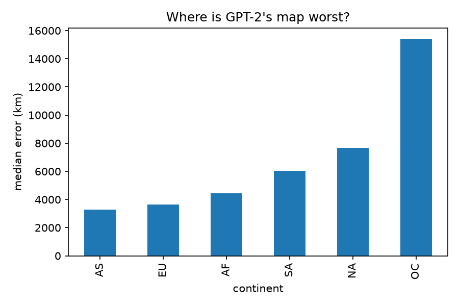
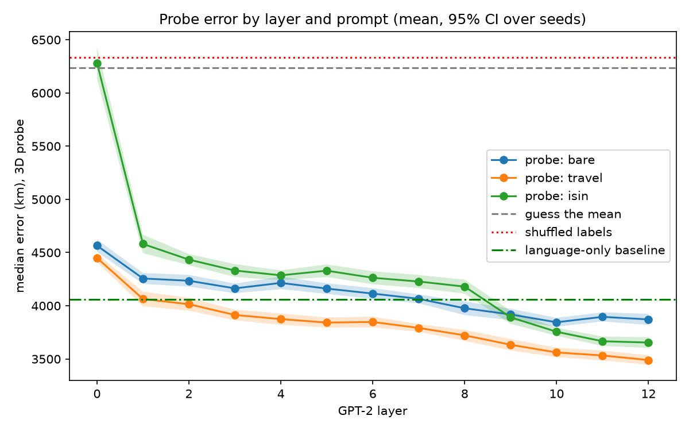
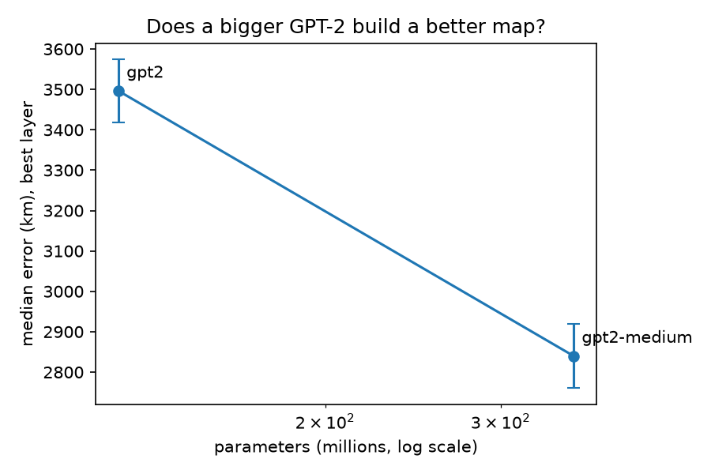

# Latent Atlas

**Does GPT-2 have a mental map of the world?** Linear probes on GPT-2's hidden states predict where 3,000 cities are, even for countries the probe never saw. Two baselines that use no model at all get surprisingly close, and this repo measures how much GPT-2 adds on top of them.

**[Try the interactive map](https://aryannnnn2.github.io/latent-atlas/)**

## Results at a glance

Median location error in km (lower is better), on cities from **held-out countries**, mean ± 95% CI over random country-to-fold splits.

| Method | Median error (km) | Seeds |
|---|---|---|
| Guess the average location | 6,234 ± 201 | 10 |
| Probe on shuffled labels (control) | 6,334 ± 167 | 10 |
| Character n-grams of the city name (no GPT-2) | 4,423 ± 66 | 10 |
| Country's primary language only (no GPT-2) | 4,058 ± 129 | 10 |
| GPT-2 small, bare city name | 3,845 ± 42 | 10 |
| GPT-2 small, "{city} is a city in" | 3,654 ± 50 | 10 |
| GPT-2 small, "I traveled to {city}" | 3,490 ± 44 | 10 |
| GPT-2 medium, "I traveled to {city}" | **2,840 ± 79** | 5 |

*In the 5-seed scale run, GPT-2 small scored 3,497 ± 78 km with the same prompt, which is consistent with the 10-seed number above.*

### Takeaways

1. **GPT-2 encodes location.** Every probe is far below both controls (about 6,200 to 6,300 km), on countries it never trained on.
2. **Much of the signal is shortcuts.** Spelling alone cuts the error to ~4,400 km, and the country's primary language alone to ~4,060 km, with no model involved.
3. **GPT-2 still adds something on top.** The bare-name probe beats the language baseline by only about 200 km, a borderline gap. With a context prompt the gap grows to about 570 km, and the larger model widens it further.
4. **Bigger is better here.** GPT-2 medium is about 650 km better than small (2,840 vs 3,497 km), with non-overlapping confidence intervals. It is a two-point comparison, not a scaling law.
5. **It fails badly in isolated regions.** Oceania is off by ~15,700 km, and the 3D probe did not fix it.

## Figures



*Figure 1. First experiment (lat/lon probe, city name only). The probe's error falls with depth, from ~4,930 km at layer 0 to ~4,120 km at layer 12, and stays well below the shuffled-label control and the guess-the-average line.*



*Figure 2. True city locations (left) vs the probe's predictions on held-out countries (right). The predicted map is a compressed, blurry version of the real one.*



*Figure 3. Median error by continent. Asia and Europe are best, Oceania is by far the worst.*



*Figure 4. 3D probe, three prompts, 10 seeds (shaded bands are 95% CIs). Context prompts help, and error keeps falling through the last layers. The "is a city in" prompt starts near the guess-the-average line at layer 0 because its last token is "in", not the city.*



*Figure 5. Best-layer error for GPT-2 small (124M) and medium (355M), prompt "I traveled to {city}".*

## Method

1. Take the 3,000 most populous cities from `geonamescache`.
2. Run each city name (bare, or inside a short prompt) through GPT-2 and save the last token's hidden state at every layer.
3. Train a Ridge regression per layer to predict the city's position as a **3D unit vector**, then convert it back to latitude and longitude. This avoids the longitude wrap-around problem. Errors are great-circle (haversine) distance in km.
4. **Hold out whole countries.** Each seed assigns countries to 5 folds at random, so the probe is always tested on countries it has never seen. A random split would let it memorize "India means this area".
5. Controls: shuffled labels, guess-the-average, a primary-language-only baseline, and a character n-gram baseline.

## Findings in detail

- **"City, Country" inputs hide the answer.** In my first experiment the last token was the country, so every city in a country got nearly the same vector. Error was ~2,260 km at every layer, which shows only that country word embeddings encode geography, so I switched to city names alone. That experiment used the lat/lon probe and a different split, so its number isn't comparable with the table above.
- **Language is in the hidden states.** A probe decodes a country's primary language with accuracy 0.33 vs 0.13 for the majority class. This shows the information is present, not that the location probe relies on it.
- **Prompts help.** "I traveled to {city}" beats the bare name by ~350 km, and the confidence intervals don't overlap.
- **Worst cases.** Australian cities (Townsville, Melbourne, Sydney) and many Philippine cities were 17,000 to 19,000 km off with the first probe.

## Limitations

- Two small models and 3,000 cities. Nothing here says how larger models behave.
- Seeds vary only the country-to-fold split, so the confidence intervals reflect split variability, not model or data variability.
- The best layer is chosen on the same test folds, which slightly favors models with more layers. The two-model scale result is a comparison, not a trend.
- "Primary language" is a crude proxy for language family. The language baseline is not tuned, and the n-gram baseline's regularization was tuned on the test folds, which if anything helps the baseline.
- Oceania: few training countries are near it, which I suspect causes the error, but I have not tested that.
- GPT-2 medium features were stored as float16 to save disk space.

## Related work

This project follows Gurnee & Tegmark (2023), *Language Models Represent Space and Time* (arXiv:2310.02207), which probes LLM hidden states for place coordinates. Probes follow Alain & Bengio (2016), and the shuffled-label control follows Hewitt & Liang (2019). This repo is a small, CPU-scale replication on GPT-2 small and medium. Its own contributions are the checks above: held-out-country evaluation with confidence intervals, the country-token leak, and two baselines that use no hidden states.

## Reproduce

```bash
pip install -r requirements.txt plotly
python extract_city.py            # GPT-2 small, bare city names
python probe_city.py              # first experiment (lat/lon probe)
python extract_templates.py       # two prompt templates
python probe_v2.py                # 3D probe, 10 seeds, controls, language baseline
python probe_ngram.py             # character n-gram baseline
python extract_model.py gpt2-medium
python probe_scale.py             # small vs medium
python make_demo.py               # interactive map in docs/
```

Everything runs on CPU. Feature files (`data/*.npy`) are not committed, so run the extraction scripts first. `common.py` holds the shared helpers. `extract.py` and `probe.py` run the original "City, Country" experiment.

## A bug worth mentioning

Namibia's country code is "NA", which pandas silently reads as missing data. It crashed the country split until I added `keep_default_na=False`.
